# Oathbound: Ashes of Aldmere



A grid-based tactical JRPG built with React + TypeScript. Lead a small band through five story
chapters: a rest area between battles, a sword/lance/axe weapon triangle, ranged bows, optional
permadeath, and bond conversations that can become romances.

## Contents

- [Play right now](#play-right-now)
- [Run from source](#run-from-source)
- [Documentation](#documentation)
- [Controls at a glance](#controls-at-a-glance)
- [Saving](#saving)
- [What's in the game](#whats-in-the-game)
- [Art and extras](#art-and-extras)
- [Project layout](#project-layout)
- [Contributing](#contributing)
- [License](#license)

## Play right now

Double-click **`Oathbound.html`**. It is a single self-contained file (all code and styles
inlined), so it runs straight from disk with no server and no install. Saves go to your browser's
local storage. The fonts load from Google Fonts when you are online; offline the game falls back
to system serif fonts.

The game targets current desktop browsers and supports mouse, keyboard and gamepad. Touch input
is not officially supported.

## Run from source

Requires Node 18+.

```bash
npm install
npm run dev        # dev server with hot reload at http://localhost:5173
npm run build      # type-checks, then writes dist/index.html (single file)
npm run preview    # serve the built game locally
npm run typecheck  # TypeScript check only
npm run export-art # render the art kit into art/
npm test           # alias of npm run sim
npm run sim        # headless check: maps, data and docs, then AI vs AI battles
npm run release    # build, then refresh the committed Oathbound.html
```

`npm run build` writes `dist/index.html`; open it straight from disk. `Oathbound.html` at the
repo root is the committed single-file release copy produced by `npm run release`.

The headless check uses esbuild: `npm run sim` bundles `test/sim.ts` for Node, and `npm test` is
its alias.

## Documentation

| Document | What covers it |
| --- | --- |
| [Player manual](docs/manual.md) | Controls (including the full controller map), rules, saving, camp, bonds, art screens |
| [Contributor guide](docs/contributing.md) | Setup, scripts, architecture, adding a chapter, release and art pipelines |
| [Troubleshooting](docs/troubleshooting.md) | Saves, controllers, fonts, camera, performance and bug reports |
| [Known limitations](docs/known-limitations.md) | Current gaps and features that are art-only |

## Controls at a glance

| Action | Input |
| --- | --- |
| Select a unit | Click it. Blue tiles = movement, red = attack range, green = heal range |
| Move | Click a blue tile, then pick Attack / Heal / Vulnerary / Seize / Wait |
| Quick attack | With a unit selected, click an enemy in red: the unit walks to the safest tile that can hit it |
| Attack | Click the target again, or press Attack in the forecast. Use **R** or ◀ ▶ to switch weapons |
| End turn | **T**, or the End turn button |
| Danger zone | **Z**, or the button. It shows every tile enemies can hit next turn |
| Undo / back | Right-click or **Esc** (undoes a move until you act) |
| Details drawer | **D**, or the Details button |
| Quicksave / quickload | **F5** / **F9** |
| Save menu / load menu | **Ctrl+S** / **Ctrl+O** (Cmd on Mac), or the buttons at camp and in the battle Menu |
| Combat animation | Click or Space to skip. Turn animations off under Menu |
| Dialogue | Click, Space or Enter to advance. Esc skips the scene |
| Rest area | WASD / arrow keys or click the ground to walk Kael. **E** (or click) to use what is nearby or talk |

While aiming, the arrow keys and D-pad step between targets. Xbox, PS5 and Steam Deck controllers
work through the browser's Gamepad API; the full controller table is in the
[player manual](docs/manual.md#controller).

## Saving

Saves live inside the browser (localStorage). There are five slots: **Quicksave** (F5 / F9),
**Autosave** (written when you arrive at camp and when you march out), and **Slots 1–3**. Ctrl+S
opens the save menu, Ctrl+O the load menu, where you can also overwrite, delete, export or import
slots. **Continue** on the title screen loads the most recent save.

You can save at the rest area, or **mid-battle** on your turn when no unit is half-way through an
action. The whole board (positions, HP, who has acted, turn number, reinforcements) is stored, so
loading resumes that exact moment. Retrying after a defeat still restarts the chapter from its
beginning.

Saves belong to one browser and one way of opening the game: the `Oathbound.html` file and
`npm run dev` keep separate saves, and clearing site data deletes them. Use **Export** and
**Import save file** in the Save/Load menu to keep a JSON backup or move progress between
browsers.

## What's in the game

- **Five chapters** with pre- and post-battle scenes, an illustrated travel map, and a walkable
  camp between battles.
- **Tactical combat** with the weapon triangle, bows, staves, terrain costs and bonuses, effective
  weapons, durability, a combat forecast, a danger zone, and optional permadeath.
- **Reactive enemies** that weigh kills, the lord and healers, counterattack risk and your army's
  threat range; wound a guard post and the nearby guards wake together.
- **A camp economy**: three activities per night, an armory with buying, selling, forging and
  repairs, plus item trading.
- **Companions and bonds**: recruits you can miss, thieves and locked chests, raiding brigands,
  dragonkin transformations, and up to 10 units deployed per battle.
- **Bonds C → A (→ S)**, with three romance pairs whose endings differ.
- **Pixel art throughout**: named characters, generic enemy types, mounts, terrain, expressive
  dialogue portraits, and animated combat scenes.
- **Input and access**: mouse, keyboard and gamepad, plus `prefers-reduced-motion` support.

The [player manual](docs/manual.md) is the reference for rules, chapter content and edge cases.

## Art and extras

Open the game with **`#sprites`** on the end of the URL (or press **Sprites** on the title screen)
for the sprite browser: every sprite, portrait and terrain tile the game can draw, with filters
for type, group, character, class, pose or expression, weapon and mount.

Open **`#gallery`** (for example `Oathbound.html#gallery`) for a model sheet of every character
type in every pose. `npm run export-art` renders the same portraits, models and world map to
standalone SVGs in `art/`; see [`art/README.md`](art/README.md). The game itself still uses no
image assets: sprites are emitted as SVG paths at runtime.

## Project layout

```
src/game/         pure TypeScript rules, data and save handling
src/components/   React UI: battle, camp, story, profiles, sprites, tiles
src/game/data/    chapters, classes, weapons, terrain, supports, profiles, camp lines
src/figure.css    keyframes for character sprite poses
src/gamepad.ts    Gamepad API support and arrow-key menu navigation
test/sim.ts       map, data and documentation checks, then AI-vs-AI auto-play
scripts/          art export and release helpers
docs/             player manual, contributor guide, troubleshooting, limitations
art/              exported SVG art kit
Oathbound.html    committed single-file release build
```

The full annotated tree is in the [contributor guide](docs/contributing.md#project-layout).

## Contributing

Node 18+ and `npm install` are enough to start. Before opening a pull request, run
`npm run typecheck` and `npm test`. `npm run release` rebuilds and refreshes `Oathbound.html`.
CI runs the same type check and tests on pushes and pull requests. See
[`CONTRIBUTING.md`](CONTRIBUTING.md) and the
[contributor guide](docs/contributing.md) for architecture, chapter authoring, conventions and
the release checklist.

## License

MIT. See [`LICENSE`](LICENSE). Copyright (c) 2026 Achyuth KP.
